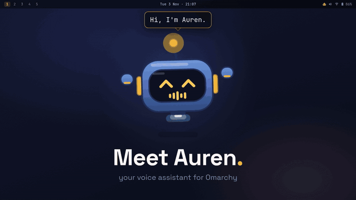
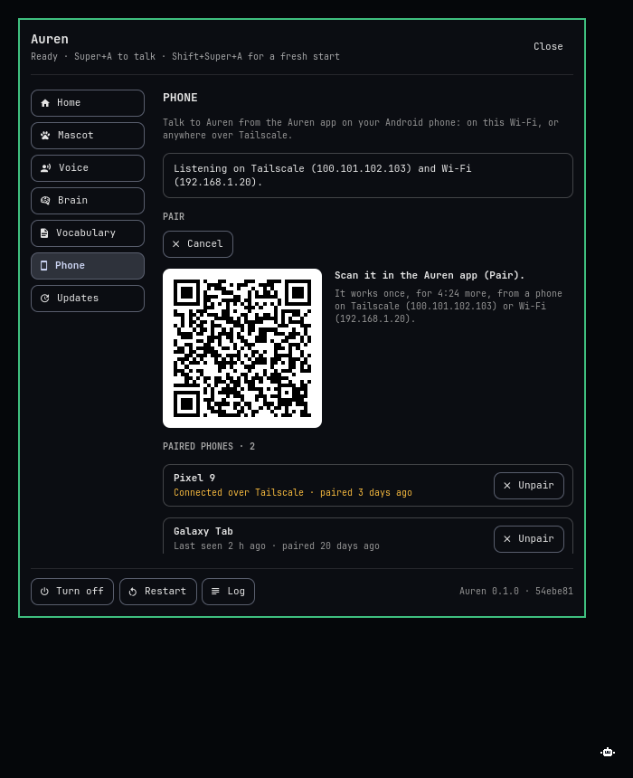

<h1 align="center">Auren</h1>

<p align="center">
  A voice assistant for Omarchy, and for macOS in preview.<br>
  Talk to it, and it opens apps, plays music, messages friends and runs coding agents in herdr.<br>
  Talk to it from your Android phone too, at home or anywhere over Tailscale.
</p>

<p align="center">
  <a href="#whats-new">What's new</a> ·
  <a href="#install">Install</a> ·
  <a href="#using-it">Using it</a> ·
  <a href="#from-your-phone">Phone</a> ·
  <a href="docs/README.md">Docs</a> ·
  <a href="CONTRIBUTING.md">Contributing</a>
</p>

<p align="center">
  
</p>

Press **Super+A** and say what you want. A tiny robot on your desktop shows what it's doing and
answers out loud. When an app has no command for something, Auren looks at the screen and uses the
mouse and keyboard.

## What's new

**Auren on your phone.** The Auren Android app is a remote for the Auren on your PC. Hold to talk, or turn
on hands-free and just keep talking, back and forth, until you go quiet. Type a request, watch what Auren
is doing, answer its yes/no questions, stop it, and switch who answers and how hard it thinks. Links,
images and files it finds land in the app's inbox. Share anything from another app to Auren, to the PC's
clipboard or to the PC's browser. It works on your Wi-Fi, and away from home over Tailscale.
[From your phone](#from-your-phone) shows how to set it up.

**A new voice.** Auren now speaks with Gradium's Phonon, in four voices: Everly, Juniper, Hugh and
Trevor. It starts talking sooner, and the model is a quarter of the old one's size. Updating downloads it
for you and deletes the old one.

**A Phone page in the bar panel** pairs a phone with a QR code, shows which phone is connected and over
which network, and unpairs one.

Everything else is in the [changelog](CHANGELOG.md).

## Install

Auren runs on [Omarchy](https://omarchy.org) and, as a preview, on Apple Silicon Macs. On both you
need Claude Code or Codex, signed in, and an [AssemblyAI](https://www.assemblyai.com/) API key for
speech to text.

### Omarchy

Auren is in the AUR:

```bash
yay -S auren
auren
```

The first `auren` sets it up for you. It asks which keys start Auren (it adds them to
`~/.config/hypr/bindings.lua` after a backup), whether to set up the browser tools so Auren can work
in your own logged-in browser, and for your AssemblyAI key. Then it adds the bar plugin, downloads
the voice model, starts Auren and runs `auren doctor`. Run `auren setup` again any time.

Updates come with your system updates (`yay`), or from the bar panel.

Installed Auren before it was a package, with `./install.sh`? Run `yay -S auren`, then
`/usr/bin/auren setup` once. It moves your install over and keeps your settings, keys and voice model.

To let a coding agent do it, paste this into Claude Code or Codex:

```text
Install Auren from https://github.com/kvm404/Auren on this Omarchy machine.
Follow "For coding agents" in its docs/install.md.
Ask all your questions at the start, then install everything in one go.
```

The [install guide](docs/install.md) covers optional extras, troubleshooting, removal, and installing
from a checkout.

### macOS (preview)

You need an Apple Silicon Mac on macOS 14 or newer, and [uv](https://docs.astral.sh/uv/)
(`brew install uv`).

```bash
git clone --branch v0.1.7 --depth 1 https://github.com/kvm404/Auren.git auren
cd auren && ./install-macos.sh
```

It installs Auren.app and opens its setup window, which walks through the permissions, the AssemblyAI
key and the brain. Then press **Control+Option+A** to talk. `auren update` installs new versions.
[Auren on macOS](docs/macos.md) has the details and what doesn't work yet.

## Using it

| | |
|---|---|
| **Super+A** (Mac: Control+Option+A) | Start talking. Press again to send, or while it works to stop it. |
| **Super+Shift+A** (Mac: Control+Option+Shift+A) | Start a fresh conversation. |
| **Mascot** | Click to talk. Drag to move it, scroll to resize it. |
| **Bar icon** (Mac: menu bar icon) | Change the mascot, voice, brain and vocabulary, pair a phone, and install updates. |

Things to try:

- "Open Obsidian on workspace 2."
- "Play some lofi on Spotify."
- "Draw how login works in Excalidraw."
- "Find the cheapest flight to Goa next Friday." (with the browser tools)
- "Ask Codex to fix the failing tests in my project."

If something doesn't work, run `auren doctor`.

## From your phone



The Auren app for Android talks to the Auren on your PC. Your phone is the microphone and the screen;
the PC does the work, with the same brain, tools and safety level as at the desk.

1. On the PC, open the bar panel's **Phone** page, click **Get the app** and scan the QR code with your
   phone's camera. Open the download. Android asks once to allow installs from your browser. (Or get
   `auren-phone-X.Y.Z.apk` from the [latest release](https://github.com/kvm404/Auren/releases/latest).)
2. On the same page, click **Pair a phone**.
3. In the app, tap **Pair** and scan the QR code.

The phone reaches the PC on the same Wi-Fi. To use it away from home, install
[Tailscale](https://tailscale.com) on both. The app moves between Wi-Fi and Tailscale by itself, and
you never need to pair again when Tailscale comes or goes.

In the app:

- **Hold to talk**, or tap **Hands-free** for a live conversation that keeps listening after each reply.
  It keeps going with the screen off, and turns off when you tap it again or go quiet for a while.
- **Type** a request instead, and **Stop** Auren from either side.
- Answer Auren's **Yes / No** questions, by tapping or by voice.
- **Fresh** (the circular arrow) starts a new conversation and clears the chat.
- **Settings** picks who answers (Auto, Claude or Codex), the effort, the voice, and whether the phone
  reads replies aloud. The phone speaks in the same voice as the PC, on its own CPU.
- The **inbox** keeps what Auren sends you: links, text, images and files.

Auren handles one request at a time, from the desk or the phone. The phone remote works with Auren on
Omarchy; the Mac gets it in a later release. [Phone remote](docs/phone.md) has the details, including
the firewall, the commands and the protocol.

<br clear="right">

## Under the hood

| | |
|---|---|
| **Brain** | Your signed-in Claude Code on Claude Haiku, with Codex as backup. No extra API key. |
| **Ears** (speech to text) | AssemblyAI, only while you're talking. |
| **Voice** (text to speech) | Gradium's Phonon, running on your own CPU, in four voices. |
| **Coding agents** | herdr (optional) |
| **Browser** | Open Browser Use (optional) |
| **Phone** | The Auren Android app, over your Wi-Fi or Tailscale, with TLS pinned to your PC's own certificate (optional) |

Haiku is quick because Auren's tools do the heavy lifting. A simple answer comes back in about two
seconds.

## Safety and privacy

Auren asks before anything risky, and always asks before publishing, buying or changing the system, except at Full access (`never`), which asks about nothing.
These checks catch mistakes, but they are not a sandbox.

Your voice goes to AssemblyAI, and your request goes to Claude or Codex. The voice, your history and
logs stay on your machine. Read [Safety](docs/safety.md) and [Privacy](docs/privacy.md) for the details.

## Contributing

Auren is free and open source. Bug reports, ideas and pull requests are welcome. Start with
[Contributing](CONTRIBUTING.md) and the [roadmap](docs/roadmap.md). Releases are listed in the
[changelog](CHANGELOG.md).

---

<p align="center">MIT licensed</p>
