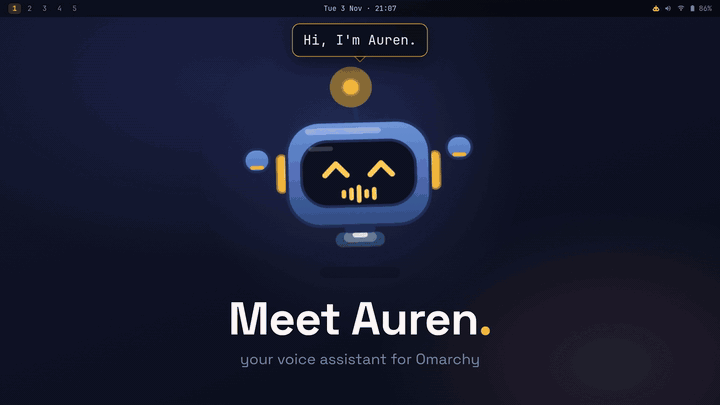

<h1 align="center">Auren</h1>

<p align="center">
  An Omarchy voice assistant.<br>
  Talk to it, and it opens apps, plays music, messages friends and runs coding agents in herdr.
</p>

<p align="center">
  <a href="#install">Install</a> ·
  <a href="#using-it">Using it</a> ·
  <a href="docs/README.md">Docs</a> ·
  <a href="CONTRIBUTING.md">Contributing</a>
</p>

<p align="center">
  
</p>

Press **Super+A** and say what you want. A tiny robot on your desktop shows what it's doing and
answers out loud. When an app has no command for something, Auren looks at the screen and uses the
mouse and keyboard.

## Install

You need Omarchy, Claude Code or Codex, and an [AssemblyAI](https://www.assemblyai.com/) API key for
speech to text.

### With a coding agent

Paste this into Claude Code or Codex. It installs Auren, sets it up and checks that it works.

```text
Install Auren from https://github.com/kvm404/Auren on this Omarchy machine.
Use the latest release and follow "For coding agents" in its docs/install.md.
Ask all your questions at the start, then install everything in one go.
```

### By hand

```bash
git clone --branch v0.1.4 --depth 1 https://github.com/kvm404/Auren.git auren
cd auren && ./install.sh
```

1. Put `ASSEMBLYAI_API_KEY=your-key` in `~/.config/auren/secrets.env`.
2. Add the key bindings the installer prints to `~/.config/hypr/bindings.lua`.
3. If you only use Codex, run `auren config set brain.mode codex`.
4. Run `systemctl --user restart auren auren-mascot`, then `auren doctor`.

The installer asks whether to set up the browser tools, so Auren can work in your own logged-in
browser. To set them up later, run `auren browser setup` or ask Auren.

The [install guide](docs/install.md) covers optional extras, troubleshooting and removal.

## Using it

| | |
|---|---|
| **Super+A** | Start talking. Press again to send, or while it works to stop it. |
| **Super+Shift+A** | Start a fresh conversation. |
| **Mascot** | Click to talk. Drag to move it, scroll to resize it. |
| **Bar icon** | Change the mascot, voice, brain and vocabulary, and install updates. |

Things to try:

- "Open Obsidian on workspace 2."
- "Play some lofi on Spotify."
- "Draw how login works in Excalidraw."
- "Find the cheapest flight to Goa next Friday." (with the browser tools)
- "Ask Codex to fix the failing tests in my project."

If something doesn't work, run `auren doctor`.

## Under the hood

| | |
|---|---|
| **Brain** | Your signed-in Claude Code on Claude Haiku, with Codex as backup. No extra API key. |
| **Ears** (speech to text) | AssemblyAI, only while you're talking. |
| **Voice** (text to speech) | Supertonic, running on your own CPU. |
| **Coding agents** | herdr (optional) |
| **Browser** | Open Browser Use (optional) |

Haiku is quick because Auren's tools do the heavy lifting. A simple answer comes back in about two
seconds.

## Safety and privacy

Auren asks before anything risky, and always asks before publishing, buying or changing the system.
These checks catch mistakes, but they are not a sandbox.

Your voice goes to AssemblyAI, and your request goes to Claude or Codex. The voice, your history and
logs stay on your machine. Read [Safety](docs/safety.md) and [Privacy](docs/privacy.md) for the details.

## Contributing

Auren is free and open source. Bug reports, ideas and pull requests are welcome. Start with
[Contributing](CONTRIBUTING.md) and the [roadmap](docs/roadmap.md). Releases are listed in the
[changelog](CHANGELOG.md).

---

<p align="center">MIT licensed</p>
