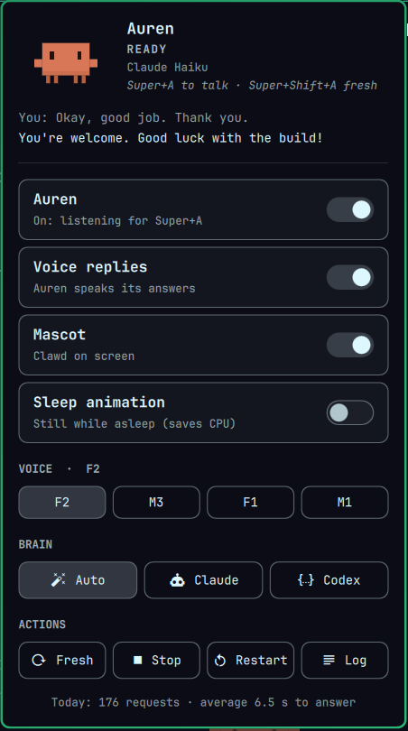
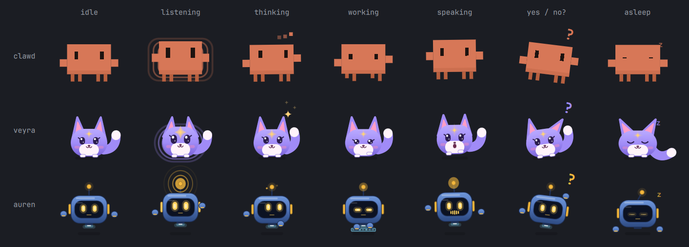

# Auren

A personal voice assistant for an Omarchy (Hyprland) laptop. Press a key, say what you want, and
Auren does it on the computer and answers out loud: it opens apps and web apps, controls windows and
media, prompts coding agents running in herdr, browses in your real logged-in browser, and, when
nothing else reaches, looks at the screen and uses the mouse and keyboard. A small mascot floats over
the desktop and shows what it's doing, and a bar plugin gives quick controls.



- **Talk:** Super+A to start, Super+A again to send. Super+Shift+A starts a fresh conversation.
  Pressing while Auren speaks interrupts it.
- **Ears:** AssemblyAI streaming speech-to-text, biased toward your own vocabulary (app names,
  projects, tools).
- **Brain:** Claude Haiku 5.5 through a Claude Code process that stays running, with Codex
  (GPT-6.1 Sol) as an automatic backup.
- **Hands:** about 40 tools over MCP, covering apps, windows, workspaces, media, volume, shell commands,
  herdr agents and jobs, the browser (Open Browser Use), screen control (look, click, drag, type) and
  saved routines.
- **Voice:** Supertonic 3, running locally on the CPU, voice F2. Replies in English or Hindi
  (Devanagari, names kept in English). Speed, quality, volume and the pause between sentences are
  adjustable.
- **Safety:** risky actions (buying, sending, deleting, `sudo` and the like) ask first. Text from
  screens and web pages is treated as untrusted.
- **Mascot:** pick one of three: Clawd (the Claude Code mascot), Veyra (a fox spirit) or Auren (a
  hover-bot). It floats over every workspace, listens, thinks, works, reacts to the voice and shows
  captions in a speech bubble. Drag it anywhere; it fades and falls asleep when idle.
- **Bar plugin:** the mascot in pixels in the Omarchy bar. Its panel has four pages: Home (talk, last
  exchange, quick switches), Mascot, Voice (voice and tuning) and Brain (who answers, Claude's effort).

<br clear="right">



## How it works

```
 Super+A ─► daemon ─► ears (AssemblyAI) ─► brain (Claude Code, Haiku 5.5) ─► voice (Supertonic)
              │                                 │ MCP
              │                                 ▼
              │                           hands: desktop · herdr · browser · screen · routines
              ▼
   $XDG_RUNTIME_DIR/auren/state.json + level ─► mascot (Quickshell) · bar plugin (Omarchy shell)
```

- `auren daemon` is a systemd user service. It listens on a Unix socket; `auren-ctl` sends it
  commands such as `talk`, `talk-fresh`, `cancel`, `voice off` and `brain codex`.
- The brain gets a live snapshot with every request (time, windows, herdr agents) plus a cached
  profile of the laptop: apps, key bindings, aliases, projects and Omarchy commands.
- The mascot and the bar plugin only read the state file and the loudness level, so either can crash
  or restart without affecting the daemon.

## Requirements

- Omarchy (Hyprland, Wayland), PipeWire. Developed on an i3 with 8 GB RAM, so everything is light.
- `uv`, `quickshell` (`qs`), `wtype`, `grim`, and write access to `/dev/uinput` for screen
  control.
- Claude Code (`claude`, logged in) for the brain; Codex (`codex`) for the backup brain.
- Optional: `herdr` for coding agents, Open Browser Use (`obu` plus its browser extension) for the
  browser tools.
- An AssemblyAI API key.

## Install

```bash
git clone https://github.com/kvm404/Auren.git auren
cd auren
./install.sh             # into ~/.local/share/auren: Python env, voice model, services, bar plugin
```

It ends with `auren doctor`, which checks everything Auren needs and says how to fix what's missing
(run it again any time). Then:

1. Put your key in `~/.config/auren/secrets.env` (`ASSEMBLYAI_API_KEY=…`).
2. Add the two key bindings and the layer rule that `install.sh` prints to your Hyprland config.
3. Restart the services: `systemctl --user restart auren auren-mascot`.

The install is a copy, so the checkout can move. To update: `git pull && ./install.sh`. To work on
Auren, use `./install.sh --dev` instead, which links the install to the checkout (see
[CONTRIBUTING.md](CONTRIBUTING.md)).

## Using it

| | |
|---|---|
| Super+A | Start talking; press again to send |
| Super+Shift+A | The same, in a fresh conversation (or say "start fresh") |
| Click the mascot | Talk (same as Super+A); while it speaks, stop it |
| Drag / scroll / right-click the mascot | Move / resize / poke |
| Bar icon | Open the panel (Home, Mascot, Voice, Brain); right-click for a fresh conversation |
| `auren doctor` | What works on this machine and how to fix what doesn't |
| `auren chat` | Type requests in a terminal and see the tool calls |
| `auren-ctl status` | Daemon state; also `voice on\|off`, `voice-name F2\|M3\|F1\|M1`, `tts speed 1.1 pause 0.2`, `brain auto\|claude\|codex`, `effort low…max`, `language en\|hi`, `forget`, `quit` |

Files:

| Path | What |
|---|---|
| `~/.config/auren/secrets.env` | API keys (chmod 600) |
| `~/.config/auren/settings.json` | Voice on/off, voice name, speed, steps, volume, pause, brain mode, Claude's effort, reply language (written by the panel and `auren-ctl`) |
| `~/.config/auren/mascot.json` | Mascot preferences: `mascot` (clawd, veyra, auren), `idleOpacity`, `fadeAfter`, `sleepAfter`, `bubble`, `sleepAnimation`, `matchVoice` |
| `~/.config/auren/routines/*.md` | Your saved workflows, given to the brain |
| `~/.local/state/auren/` | History, daemon log, herdr jobs, mascot position |
| `~/.local/share/auren/` | The installed program and the voice model |

## Project layout

```
src/auren/         daemon, ears, voice, brain/, hands/, server (MCP tools), safety, profile/
mascot/            the floating mascot (Quickshell); mascots/{clawd,veyra,auren}/ are the characters,
                   mascots/common/ what they share, gallery.qml shows them all
omarchy-plugin/    the bar plugin (krvm.auren)
systemd/           unit templates (install.sh fills in the paths)
bin/auren-ctl      runs the installed auren-ctl (for key bindings that point into the checkout)
docs/              how each piece works, decisions, research
experiments/       the TTS, STT and brain comparisons behind the decisions
tests/             uv run pytest
```

## Docs

- [Architecture](docs/architecture.md): the design that makes Auren work on any Omarchy machine, and
  its build order. [Daemon contract](docs/ipc.md): state file, socket commands, files.
- [Roadmap](docs/roadmap.md): pieces, status, what's next.
- [Contributing](CONTRIBUTING.md).
- Decisions: [voice](docs/decisions/0001-assistant-voice.md),
  [speech-to-text](docs/decisions/0002-speech-to-text.md), [brain](docs/decisions/0003-brain.md).
- How it works: [daemon](docs/daemon.md), [hands](docs/hands.md), [safety](docs/safety.md),
  [system profile](docs/system-profile.md), [mascot](docs/mascot.md), [bar plugin](docs/bar-plugin.md).

## Credits

- Clawd is the Claude Code mascot by Anthropic, drawn here for personal use. Veyra and Auren are
  Auren's own mascots.
- [Supertonic](https://github.com/supertone-inc/supertonic) for the voice, AssemblyAI for speech
  recognition, Open Browser Use for the browser, Quickshell and Omarchy for the desktop side.

Personal project, not licensed for reuse.
