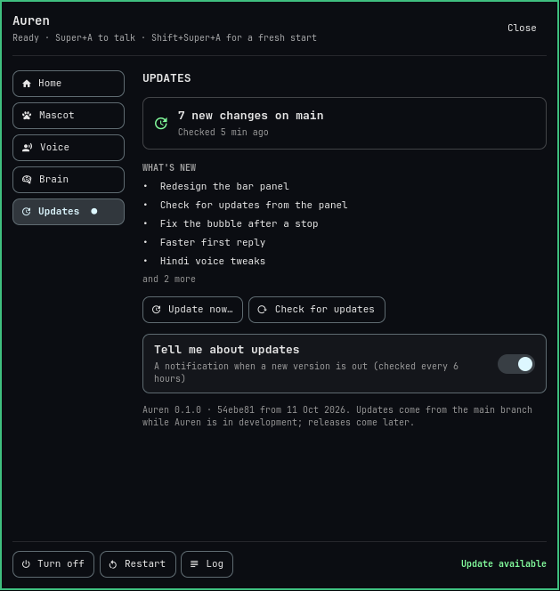

# Bar plugin

`krvm.auren`, an Omarchy shell bar widget. Code: `omarchy-plugin/` (`manifest.json`, `Panel.qml`, and its
parts `MiniMascot.qml`, `Choice.qml` (a titled row of buttons), `SliderRow.qml`), linked as
`~/.config/omarchy/plugins/krvm.auren`.
Enabled with `omarchy plugin enable krvm.auren --before krvm.agents` (a `shell.json` backup was made first).

## Bar icon

The chosen mascot in pixels (Auren 16x12, Veyra 16x11, one pixel per unit):
- **idle:** bar colour;
- **active** (listening, thinking, working, speaking, waiting for a yes/no): the mascot's colour, bobbing
  (Auren's eyes and antenna light up gold, his thruster cyan); Auren's hand up while listening;
- **error:** red;
- **off:** dim, eyes shut.

Hover shows the status. **Click** opens the panel; **right-click** starts a fresh conversation. A dot in
the corner means an update is out.

## Panel

Laid out like Omarchy's own settings panels (Spaces settings, for one): a header with Auren's status and
Close, the pages down the left, the page on the right, and Turn on/off, Restart and Log at the bottom, next
to the installed version (or "Update available", which opens the Updates page). Built with Omarchy's
`qs.Ui` parts (`KeyboardPanel`, `Button`, `Toggle`, `PanelSlider`, `PanelSectionHeader`), so it follows
the theme. The panel keeps the height of its tallest page, so it doesn't jump between pages.

Keys: arrows or hjkl. On the pages, up/down changes page; right or Enter goes into it, and left from its
first column comes back. In a page, up/down moves between rows, left/right between buttons or along a
slider. Enter acts, Esc closes (or cancels an update you were about to start), Tab goes to the next bar
panel. It remembers the last page while the shell runs.

| Page | What | How |
|---|---|---|
| **Home** | the live mascot (**click it to talk**, again to send; while it thinks, works or speaks, stop it; right-click to poke; starts Auren when it's off); quick switches: On, Voice, Mascot, Fresh, Stop; the last exchange | `auren-ctl talk/voice/forget/cancel`, `systemctl --user start/stop auren auren-mascot`, `~/.local/state/auren/history.jsonl` |
| **Mascot** | Auren or Veyra as live previews (click to choose; it says hello in its voice); speech bubble; sleep animation (~6% CPU); voice follows mascot; how faded it gets when idle; size; reset place; poke | writes `mascot`, `bubble`, `sleepAnimation`, `matchVoice`, `idleOpacity` in `~/.config/auren/mascot.json` (the mascot reloads it); size, reset and poke through the mascot's IPC |
| **Voice** | voice replies on/off; reply language (English, Hindi); voice F2 (Auren's), M3, F1, M1 (decision 0001's shortlist; a click plays a sample); speed 0.8–1.4×; quality Fast/Balanced/Best (3, 5, 8 steps); volume; pause between sentences; Test; Defaults | `auren-ctl voice`, `language`, `voice-name`, `tts …`, `say` (the Test sentence is Hindi in Hindi, with the verb gender of the voice) |
| **Brain** | who answers: Auto (Claude, Codex on a limit) / Claude only / Codex only, and which is answering now; Claude's effort (Low, Medium, High, XHigh, Max; changing it starts a fresh conversation; greyed out in Codex-only mode); today's requests, average time to answer, how many Codex answered | `auren-ctl brain`, `auren-ctl effort`, history log |
| **Updates** | the installed version; Check for updates; when one is out, what's new (the commit titles) and **Update now…**, which says what will happen and asks before it starts; progress while it runs, then the result (and the update log); "Tell me about updates" | `auren update check [--notify]`, `auren update apply`, `$XDG_RUNTIME_DIR/auren/update.json`, `~/.local/share/auren/install.json`, `~/.config/auren/panel.json` |

**Updates** (see [architecture.md](architecture.md#updates)): the panel checks quietly a few minutes after
the bar starts and every 6 hours, and when you open the Updates page if the last check is over 30 minutes
old. When a new version is out, the bar icon gets a dot and, with "Tell me about updates" on, a
notification says so, once per version. Updating waits until Auren is idle, then stops it, installs and
starts it again; if the panel itself changed, the bar restarts to load it.

The daemon keeps voice, brain and the voice tuning in `~/.config/auren/config.toml` and puts them in
`state.json` (`voice`, `voiceName`, `mode`, `tts`), so the panel, the mascot and restarts all agree.
A slider shows its new value as soon as it's released; the daemon's next state confirms it.

**Voice follows mascot** (on by default): picking Auren switches to M3, Veyra to F2, and the
mascot says hello in it. Only when Auren is idle with voice replies on. Choosing a voice by hand still
works; it stays until the next mascot change.

From a script or key binding: `omarchy-shell krvm.auren toggle` (or `open`, `close`).

## Notes

- **Preview without the bar:** `tests/panel/preview.sh [out-dir] [pages]` renders the pages to PNGs with a
  separate, off-screen Quickshell (Omarchy's UI parts, sample data, temp folders), so it touches neither
  the running bar nor Auren. The pictures on this page come from it.
- **Code changes need `omarchy restart shell`.** The plugin folder is a link into the repo, and the shell's
  change watcher doesn't see edits through it (`rescanPlugins` doesn't reload code either).
- The plugin bar API has `run(command)` but no `shellQuote` (the bar README lists it). The plugin starts
  its commands with `Quickshell.execDetached([...])` instead. The first version called `shellQuote`, so every
  auren-ctl action in the panel failed until this was fixed.

- Quickshell's file watch does see the daemon's write-then-rename updates of `state.json` (tested), so the
  plugin and the mascot only re-read it every 10 s as a safety net. They used to re-read it every second,
  which caused "dropped operation" warnings.
- A `JsonAdapter` keeps a property's old value when its key is deleted from the file (only a written value
  changes it), so to switch the mascot by hand, set `"mascot"` rather than removing it.
- Dictation will get its switch here when it's built (probably on Home).
