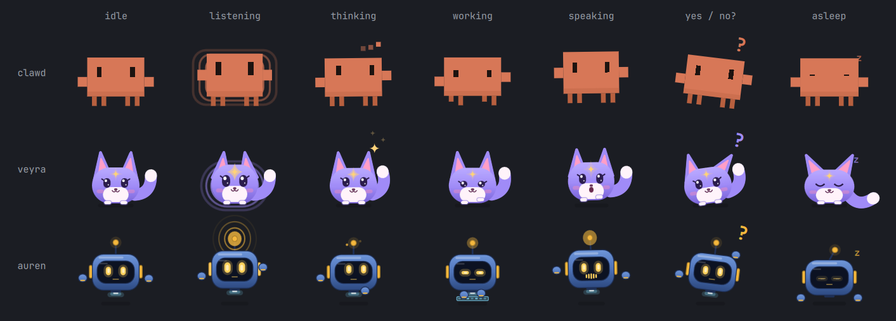

# Mascot

A small character floats over the desktop and shows what Auren is doing: **Clawd** (the Claude Code
mascot, the default), **Veyra** (a fox spirit) or **Auren** (a hover-bot). Pick one on the bar panel's
Mascot page, or set `mascot` in `~/.config/auren/mascot.json`; it switches live.

| | |
|---|---|
| Code | `mascot/shell.qml` (windows, input, bubble), `mascot/mascots/<name>/` (the characters), `mascot/mascots/common/` (what they share) |
| Runs as | `auren-mascot.service`, a systemd user service: `qs -n -p ~/.local/share/auren/mascot` |
| Reads | `$XDG_RUNTIME_DIR/auren/state.json` (state, live transcript, activity, caption, yes/no question), `$XDG_RUNTIME_DIR/auren/level` (mic or voice loudness, ~20/s) |
| Remembers | `~/.local/state/auren/mascot.json` (place, size, hidden) |
| Preferences | `~/.config/auren/mascot.json` (optional): `mascot` clawd, `idleOpacity` 0.45, `fadeAfter` 12 s, `sleepAfter` 240 s, `bubble` true, `sleepAnimation` true, `matchVoice` true (read by the bar panel) |

## The characters



| | Clawd | Veyra | Auren |
|---|---|---|---|
| Is | the Claude Code logo's blocks, walking | a lavender fox spirit: big ears, glossy eyes with lashes, a gold star on her forehead, a fluffy tail | a cobalt hover-bot: dark glass visor with gold LED eyes, antenna, floating hands, thruster glow |
| Listening | stands tall, rings | ears perk and twitch with your voice, the star glows, rings | radio rings from the antenna, a hand cupped at his ear |
| Thinking | sways, three dots | looks up, tail curls, sparkles twinkle | hand on his chin, two sparks orbit the antenna |
| Working | walks, arms typing | paws tapping, tail wagging fast | types on a hologram keyboard; eyes narrow to a scan |
| Using the mouse | a clicking cursor by its arm | the same, by her side | holds the pointer in his right hand |
| Speaking | bounces and waves | mouth opens with the voice, little hops | the mouth is a little equalizer |
| Yes/no | head tilt, "?" | head tilt, one ear folded, "?" | head tilt, scratching his head, "?" |
| Error | shakes, X eyes | ears flat, X eyes | red visor, X eyes, sparks |
| Asleep | eyes shut, z's | ears droop, eyes ‿ ‿, tail wrapped down | sinks to the ground, thruster off, dim eyes |
| Voice (if "voice follows mascot") | F2 | F2 | M3 |
| Colour (bar icon, panel accents) | orange `#D77757` | lavender `#A08BF7` | gold `#F5B83D` (body cobalt) |

## What it shows

The table uses Clawd; the others do the same in their own way (above).

| Auren is | Clawd | Bubble |
|---|---|---|
| starting | wakes up and hops | "Waking up…" |
| idle | breathes, blinks, glances around; fades after 12 s; falls asleep (eyes shut, z's) after 4 min | — |
| listening | stands tall, wide eyes, rings that grow with your voice | the live transcript |
| thinking | sways, looks up, three dots | what you said |
| working | walks in place, arms typing; a clicking cursor when it uses the mouse | what it's doing ("Opening WhatsApp", "Clicking Allow button") |
| speaking | hops in, bounces and waves to the voice's loudness | the sentence being spoken (captions) |
| waiting for a yes/no | head tilt, "?" | the question + "Hold to answer yes or no" |
| error | shakes, dizzy X eyes | the error |
| off (daemon not running) | grey, asleep | on hover: "click to start" |

After a reply it smiles (^ ^, blush).

## Using it

- **Drag** to move it anywhere; the place is remembered.
- **Click** it to talk (same as Super+A); click again to send. While Auren speaks, a click stops it. When Auren is off, a click starts it.
- **Right-click** for a poke (it hops).
- **Scroll** over it to resize.
- **Hover**: it wakes up, looks at the pointer, and shows the hint.

Remote control (for the bar plugin):

```bash
qs -p ~/.local/share/auren/mascot ipc call mascot toggle   # show, hide, poke, reset, state, size 1.2
systemctl --user restart auren-mascot
```

## How it's built

- **Quickshell** (QML), the same toolkit as the Omarchy shell, run as its own small instance so a
  mascot bug can't affect the bar. It's a layer-shell surface on the overlay layer: on every
  workspace, never takes keyboard focus, not in the window list.
- **Input mask** = the body only, so clicks around it reach the windows below. The bubble is a
  second layer surface with an empty input mask (fully click-through).
- **Dragging:** while dragging, the window covers the whole screen and Clawd moves inside it, so no
  compositor round trip per mouse move; on release it shrinks back to Clawd's size at the new place.
- **Animation:** every pose is oscillators driven by one clock × mood weights that fade in and out,
  so moods blend instead of jumping. The clock runs every frame only while Auren is doing something.
  Idle breathing is stepped at 10 fps, and the clock stops once the mascot has faded. All of this is in
  `mascots/common/MascotBase.qml`; each character only adds its pose and drawing.
- **Fading** draws the mascot as one picture (`layer.enabled` while its opacity is below 1). Without it,
  Qt fades each part on its own and overlapping parts (Veyra's ears and tail, Auren's hands) show
  through the body.
- **Captions and bounce:** the voice keeps a timeline of when each sentence's audio actually plays and
  its loudness envelope; a small thread reports the current sentence and level (`src/auren/voice.py`).
  The mic level comes from the audio chunks the ears already read (`src/auren/ears.py`).
- **Activity phrases:** `src/auren/live.py` turns tool calls into short phrases.
- The daemon skips the Omarchy OSD while the mascot is running (`daemon.mascot_running()`).
- Bubble colours follow the current Omarchy theme (`~/.local/state/omarchy/current/theme/colors.toml`).

## Measured (2026-10-10)

- **CPU:** ~6% of a core with 60 fps idle breathing in the first version, so the clock was changed:
  ~1% while awake and idle, ~0.6% once faded. The user wanted the smooth sleeping animation back, so
  `sleepAnimation` (default on) keeps the smooth clock and drifting z's while faded or asleep: ~6% of a
  core. Set it to false in `~/.config/auren/mascot.json` for the cheap mode; the bar plugin will toggle it.
- **Memory:** ~104 MB private. A bare Quickshell window is already ~78 MB, so the mascot itself is
  ~25 MB. Moving it into the Omarchy shell process as a plugin would save the ~78 MB; that's
  worth doing with the bar plugin if memory gets tight.

## Gotchas

- **Hyprland animates layer surfaces when they move or resize** (Omarchy's `layers` animation). A drag
  resizes the window to full screen, so during the slide the pointer positions were relative to a moving
  window and Clawd drifted away from the cursor (reported by the user with a recording). Fix: a layer
  rule in `~/.config/hypr/hyprland.lua`, the same thing Omarchy does for its bar:
  `hl.layer_rule({ match = { namespace = "^auren-mascot" }, no_anim = true, animation = "none" })`.
  The drag code also checks each event against both possible window origins (mascot-sized or full
  screen), because Qt learns the new size a moment before the compositor applies it.
- Before that fix, one fast drag test crashed the mascot with "Wayland connection experienced a fatal
  error: Protocol error" (systemd restarted it in 3 s). It didn't happen again in 75 rapid drags after
  the fix, and the cause isn't known.

- Cursor warps (`hyprctl dispatch hl.dsp.cursor.move`) during a button press don't produce motion
  events for clients. To test dragging, use relative motion from a virtual mouse (`REL_X`/`REL_Y`).
- Quickshell hot-reloads on save, but a reload can leave a layer surface's margins stale until the next
  change; restart the service to be sure.

## Making a mascot

A mascot is a folder under `mascot/mascots/<name>/` with `<Name>.qml`, whose root is a `MascotBase`
(`mascots/common/`). The base holds the contract with `shell.qml` and the bar panel:
- **in:** u, mood, level, drowsy, asleep, sleepAnimation, mouse, awaiting, hovered, pointerX/Y, off;
- **out:** implicitWidth/Height, padX/padTop (where its stage starts), hitbox (an Item on the stage, the
  input mask), bubbleAnchorY, accent;
- **functions:** `poke()`, `cheer()`;
- **for drawing:** the clock `t`, `osc(hz, phase)`, `pulse()`, `mix()`, mood weights (`wListen`, `wSway`,
  `wWork`, `wSpeak`, `wAsk`, `wSleep`, `wError`…), `lv` (smoothed loudness), `hopA`/`squashA`/`shakeA`,
  `happy`, `blink`, `lookX/Y`, `eyeShape`, `breath`. Shared pieces: `Zzz`, `Pointer`, `Sparkle`.

Then add it to `kind` and the components in `shell.qml`, `mascots` in the bar panel, and pixels in
`omarchy-plugin/MiniMascot.qml`.

To see every mascot in every mood (it's how Veyra and Auren were drawn and checked):

```bash
qs -p mascot/gallery.qml                                    # on screen; right-click one to poke it
GALLERY_OUT=/tmp/g.png qs -p mascot/gallery.qml             # save a PNG and quit
GALLERY_U=10 GALLERY_ONLY=idle,speaking GALLERY_BG=#efece4 GALLERY_OUT=/tmp/g.png qs -p mascot/gallery.qml
```

Quickshell only knows a folder's QML types when that folder is imported somewhere, so `shell.qml` and
`gallery.qml` import every mascot folder even though they load them by name.
